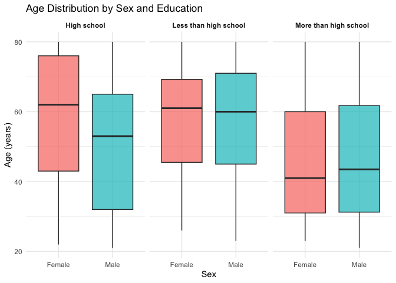
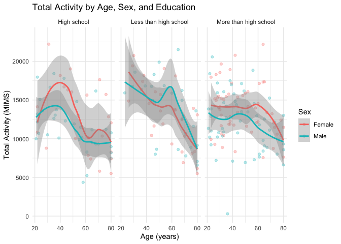
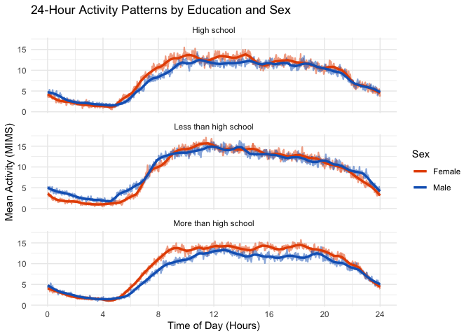
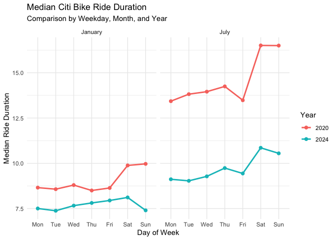
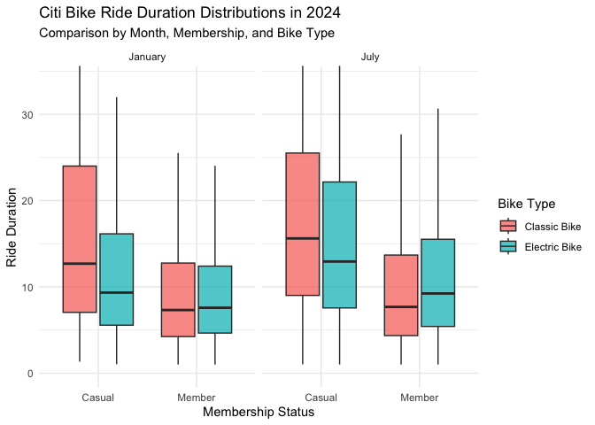

p8105_hw3_imo2121
================
Ian O’Keeffe
2026-10-14

## Problem 1

``` r
noaa_df = ny_noaa %>% 
  janitor::clean_names()

na_count <- noaa_df %>%
  summarize(across(everything(), ~ mean(is.na(.)) * 100 ))
```

This dataframe contains 2595176 rows and 7 columns. The key variables
include date, prcp (the amount of precipitation that day, in tenths of
mm) snow (in mm), snwd (depth of the snow that day, in mm) tmax and tmin
(the maximum and minimum temperatures that day in tenths of degrees C).
Missing data is an issue here, as every weather station does not collect
every value. Accordingly, 14.69% of the snow data, 22.8% of snow depth,
and 43.71% of both temp min and temp max data are missing.

``` r
noaa_df = noaa_df %>% 
  mutate(
    day = lubridate::day(date),
    month = lubridate::month(date),
    year = lubridate::year(date),
    snow = ifelse(
      snow < 0, NA, snow
    ),
    prcp = prcp / 10,
    tmin = as.numeric(tmin) / 10,
    tmax = as.numeric(tmax) / 10
  )

noaa_df %>% 
  count(snow, name = "n_obs") %>% 
  arrange(desc(n_obs))
```

    ## # A tibble: 281 × 2
    ##     snow   n_obs
    ##    <int>   <int>
    ##  1     0 2008508
    ##  2    NA  381222
    ##  3    25   31022
    ##  4    13   23095
    ##  5    51   18274
    ##  6    76   10173
    ##  7     8    9962
    ##  8     5    9748
    ##  9    38    9197
    ## 10     3    8790
    ## # ℹ 271 more rows

``` r
head(noaa_df)
```

    ## # A tibble: 6 × 10
    ##   id          date        prcp  snow  snwd  tmax  tmin   day month  year
    ##   <chr>       <date>     <dbl> <int> <int> <dbl> <dbl> <int> <dbl> <dbl>
    ## 1 US1NYAB0001 2007-11-01    NA    NA    NA    NA    NA     1    11  2007
    ## 2 US1NYAB0001 2007-11-02    NA    NA    NA    NA    NA     2    11  2007
    ## 3 US1NYAB0001 2007-11-03    NA    NA    NA    NA    NA     3    11  2007
    ## 4 US1NYAB0001 2007-11-04    NA    NA    NA    NA    NA     4    11  2007
    ## 5 US1NYAB0001 2007-11-05    NA    NA    NA    NA    NA     5    11  2007
    ## 6 US1NYAB0001 2007-11-06    NA    NA    NA    NA    NA     6    11  2007

We add day, month, and year columns. Snow values less than 0 were
changed to be NAs. We then adjust the prcp, tmax, and tmin to be full mm
and degrees C, respectively. The majority of counts for snowfall were 0,
since it does not snow in most places on most days.

``` r
ggp_monthly_temp = noaa_df %>%
  filter(
    month %in% c(1, 7)
  ) %>% 
  mutate(
    month = ifelse(
      month == 1, "January", "July"
    )
  ) %>%
  group_by(id, month, year) %>%
  summarize(
    avg_max = mean(tmax)
  )  %>%
  ggplot(aes(x = year, y = avg_max)) +
  geom_point(size = 2) +
  facet_wrap(~ month, ncol = 2) +
  labs(
    title = "Average Temperature by Station and Month",
    x = "Year",
    y = "Average Monthly Temperature (C)"
  )
```

    ## `summarise()` has regrouped the output.
    ## ℹ Summaries were computed grouped by id, month, and year.
    ## ℹ Output is grouped by id and month.
    ## ℹ Use `summarise(.groups = "drop_last")` to silence this message.
    ## ℹ Use `summarise(.by = c(id, month, year))` for per-operation grouping
    ##   (`?dplyr::dplyr_by`) instead.

``` r
ggp_monthly_temp
```

    ## Warning: Removed 7058 rows containing missing values or values outside the scale range
    ## (`geom_point()`).

<!-- -->
The plots of average temperatures in January and July show relatively
consistent temperatures, with a few outliers (e.g. one very cold day in
July in the late 1980s).

``` r
ggp_full_tmp = noaa_df %>%
  pivot_longer(
    tmax:tmin,
    names_to = "observation", 
    values_to = "temp") %>%  
  ggplot(aes(x = temp, fill = observation)) +
  geom_density(alpha = .5) +
  labs(
    title = "Average Temperature by Station and Month",
    x = "Temperature (C)",
    y = "Density"
  )

ggp_snowfall = noaa_df %>% 
  filter(
    snow > 0 & snow < 100
  ) %>% 
  count(year, name = "snow_count") %>% 
  ggplot(aes(x = year, y=snow_count)) +
  geom_line() +
  labs(
    title = "Snowfall Amounts",
    x = "# of Snowfalls between 0 and 100mm",
    y = "Year"
  ) +
  theme(legend.position="none")
  

ggp_full_tmp + ggp_snowfall
```

    ## Warning: Removed 2268778 rows containing non-finite outside the scale range
    ## (`stat_density()`).

<!-- -->

We made two density plots. The left compares minimum and maximum
temperature by station and month, while the right shows how often
stations recorded days with snowfalls between 0 and 100 millimeters by
year.

## Problem 2

``` r
accel_df = read.csv("./files/nhanes_accel.csv") %>% 
  janitor::clean_names() %>% 
  pivot_longer(
    min1:min1440,
    names_to = "minute", 
    values_to = "mims"
    )
covar_df = read.csv("./files/nhanes_covar.csv", skip = 4) %>% 
  janitor::clean_names() %>% 
  mutate(
    sex = as.factor(ifelse(sex == 1, "Male", "Female")), 
    education = as.factor(recode_values(
      education,
        1 ~ "Less than high school",
        2 ~ "High school",
        3 ~ "More than high school"
      ))
  )

mims_df = accel_df %>% 
  left_join(covar_df, 'seqn')

head(mims_df)
```

    ## # A tibble: 6 × 7
    ##    seqn minute  mims sex     age   bmi education  
    ##   <int> <chr>  <dbl> <fct> <int> <dbl> <fct>      
    ## 1 62161 min1   1.11  Male     22  23.3 High school
    ## 2 62161 min2   3.12  Male     22  23.3 High school
    ## 3 62161 min3   1.47  Male     22  23.3 High school
    ## 4 62161 min4   0.938 Male     22  23.3 High school
    ## 5 62161 min5   1.60  Male     22  23.3 High school
    ## 6 62161 min6   0.145 Male     22  23.3 High school

We load and tidy the datasets, pivoting the minutes into their own rows
for the acceleration csv and changing from codes to male and female. We
then left join them on the ‘seqn’ column.

``` r
mims_df = mims_df %>% 
  filter(age >= 21) %>%
  group_by(seqn) %>% 
  filter(!any(if_any(everything(), is.na))) %>% 
  ungroup() %>% 
  mutate(
    education = as.factor(education),
    minute = as.numeric(str_remove(minute, "^min"))
  )
head(mims_df)
```

    ## # A tibble: 6 × 7
    ##    seqn minute  mims sex     age   bmi education  
    ##   <int>  <dbl> <dbl> <fct> <int> <dbl> <fct>      
    ## 1 62161      1 1.11  Male     22  23.3 High school
    ## 2 62161      2 3.12  Male     22  23.3 High school
    ## 3 62161      3 1.47  Male     22  23.3 High school
    ## 4 62161      4 0.938 Male     22  23.3 High school
    ## 5 62161      5 1.60  Male     22  23.3 High school
    ## 6 62161      6 0.145 Male     22  23.3 High school

Education and minute are changed to factors, and rows for people under
21 years old are removed. We also remove any participants with na
values.

``` r
education_table <- mims_df %>%
  count(education, sex) %>%
  pivot_wider(
    names_from = sex,
    values_from = n,
    values_fill = 0
  ) %>%
  mutate(Total = Male + Female) %>%
  arrange(education)

kable(
  education_table,
  col.names = c("Education", "Men", "Women", "Total")
)
```

| Education             |   Men | Women |  Total |
|:----------------------|------:|------:|-------:|
| High school           | 33120 | 50400 |  83520 |
| Less than high school | 40320 | 38880 |  79200 |
| More than high school | 84960 | 80640 | 165600 |

We create a chart with education levels by sex, along with totals. The
largest category is More than high school.

``` r
ggplot(
  mims_df,
  aes(x = sex, y = age, fill = sex)
) +
  geom_boxplot(alpha = 0.7) +
  facet_wrap(~ education) +
  labs(
    title = "Age Distribution by Sex and Education",
    x = "Sex",
    y = "Age (years)",
    fill = "Sex"
  ) +
  theme_minimal() +
  theme(
    legend.position = "none",
    strip.text = element_text(face = "bold")
  )
```

<!-- -->

The people with more than a high school education are generally younger
than the other education levels. Among people with a high school
education, the females with were older than the males.

``` r
activity_totals <- mims_df %>%
  group_by(seqn, sex, age, education) %>%
  summarize(
    total_activity = sum(mims),
    .groups = "drop"
  )

ggplot(activity_totals,
       aes(x = age, y = total_activity, color = sex)) +
  geom_point(alpha = 0.3) +
  geom_smooth(method = "loess", se = TRUE) +
  facet_wrap(~ education) +
  labs(
    title = "Total Activity by Age, Sex, and Education",
    x = "Age (years)",
    y = "Total Activity (MIMS)",
    color = "Sex"
  ) +
  theme_minimal()
```

    ## `geom_smooth()` using formula = 'y ~ x'

<!-- -->

As age increases, total activity decreases across all education levels
and sexes. Women tended to do more activity than men for groups with at
least a high school education, while the opposite was generally true for
people with less than a high school education.

``` r
activity_by_minute <- mims_df %>%
  group_by(education, sex, minute) %>%
  summarize(
    mean_mims = mean(mims),
    .groups = "drop"
  )

ggplot(activity_by_minute,
       aes(x = minute / 60,
           y = mean_mims)) +
  geom_line(
    linewidth = 0.8,
    aes(color = sex),
    alpha = 0.5) +
  geom_smooth(
    aes(color = sex), 
    method = "loess",
    span = 0.08,
    se = FALSE,
    linewidth = 1.2
  ) +
  scale_color_manual(values = c("Male" = "#1565C0", "Female" = "#E65100")) +
  facet_wrap(~ education, ncol = 1) +
  scale_x_continuous(
    breaks = seq(0, 24, by = 4),
    limits = c(0, 24)
  ) +
  labs(
    title = "24-Hour Activity Patterns by Education and Sex",
    x = "Time of Day (Hours)",
    y = "Mean Activity (MIMS)",
    color = "Sex"
  ) +
  theme_minimal()
```

    ## `geom_smooth()` using formula = 'y ~ x'

<!-- -->

The plots of 24 hour activity show low activity in the early morning,
with generally sustained energy throughout the middle of the day and
into the night.

## Problem 3

``` r
jan_2020_citi_df <- read.csv("./files/Jan 2020 Citi.csv") %>%   
  janitor::clean_names()
jan_2024_citi_df <- read_csv("./files/Jan 2024 Citi.csv") %>%   
  janitor::clean_names()
jul_2020_citi_df <- read_csv("./files/July 2020 Citi.csv") %>%   
  janitor::clean_names()
jul_2024_citi_df <- read_csv("./files/July 2024 Citi.csv") %>%   
  janitor::clean_names()

citi_df <- bind_rows(
  jan_2020_citi_df %>% mutate(year = 2020, month = "January"),
  jan_2024_citi_df %>% mutate(year = 2024, month = "January"),
  jul_2020_citi_df %>% mutate(year = 2020, month = "July"),
  jul_2024_citi_df %>% mutate(year = 2024, month = "July")
) %>%
  mutate(
    month = factor(month, levels = c("January", "July")),
    member_casual = factor(member_casual,
                           levels = c("casual", "member"),
                           labels = c("Casual", "Member")),
    year = factor(year)
  )

head(citi_df)
```

    ##            ride_id rideable_type  weekdays duration         start_station_name
    ## 1 4BE06CB33B037044  classic_bike   Tuesday     15.3     Columbus Ave & W 95 St
    ## 2 26886E034974493B  classic_bike Wednesday      5.3            2 Ave & E 96 St
    ## 3 24DC56060EBE6260  classic_bike    Friday      9.7 Columbia St & Rivington St
    ## 4 EEDC1053582D02E5  classic_bike    Sunday      7.0     W 84 St & Columbus Ave
    ## 5 2CD4BD4CEE2E50A9  classic_bike    Friday      2.8     Forsyth St & Broome St
    ## 6 E18682F9A4E501BB  classic_bike    Sunday     25.5       Allen St & Hester St
    ##           end_station_name member_casual year   month
    ## 1    E 53 St & Madison Ave        Member 2020 January
    ## 2         1 Ave & E 110 St        Member 2020 January
    ## 3  Grand St & Elizabeth St        Member 2020 January
    ## 4   Columbus Ave & W 72 St        Member 2020 January
    ## 5  Suffolk St & Stanton St        Member 2020 January
    ## 6 Atlantic Ave & Furman St        Member 2020 January

We import the 4 csv files, add columns for year and month, then bind
them into one dataframe. We turn month, membership, and year into
factors. We end up with a dataframe of 99485 rows and `rncol(citi)`
columns. The rows indicate a single rental of a bike, and the columns
are ride id, rideable type (classic or ebike), day of the week, ride
duration, the starting and ending station, membership of the rider,
year, and month.

``` r
ride_counts <- citi_df %>%
  count(year, month, member_casual) %>%
  pivot_wider(
    names_from = member_casual,
    values_from = n,
    values_fill = 0
  ) %>%
  mutate(Total = Casual + Member) %>%
  arrange(year, month)

kable(
  ride_counts,
  caption = "Total Citi Bike Rides by Year, Month, and Membership",
  col.names = c("Year", "Month", "Casual Riders",
                "Members", "Total Rides"),
  format.args = list(big.mark = ",")
)
```

| Year | Month   | Casual Riders | Members | Total Rides |
|:-----|:--------|--------------:|--------:|------------:|
| 2020 | January |           984 |  11,436 |      12,420 |
| 2020 | July    |         5,637 |  15,411 |      21,048 |
| 2024 | January |         2,108 |  16,753 |      18,861 |
| 2024 | July    |        10,894 |  36,262 |      47,156 |

Total Citi Bike Rides by Year, Month, and Membership

There are more rides in July each year than in January. Ridership has
increased between 2020 and 2024 in both January and July. Most rides are
by citibike members. Members make up a much larger proportion of total
rides in January of both years than they do in July.

``` r
top_stations <- jul_2024_citi_df %>%
  filter(!is.na(start_station_name),
         start_station_name != "") %>%
  count(start_station_name, sort = TRUE) %>%
  slice_head(n = 5) %>%
  rename(
    "Starting Station" = start_station_name,
    "Number of Rides" = n
  )

kable(
  top_stations,
  caption = "Five Most Popular Citi Bike Starting Stations, July 2024",
  format.args = list(big.mark = ",")
)
```

| Starting Station         | Number of Rides |
|:-------------------------|----------------:|
| Pier 61 at Chelsea Piers |             163 |
| University Pl & E 14 St  |             155 |
| W 21 St & 6 Ave          |             152 |
| West St & Chambers St    |             150 |
| W 31 St & 7 Ave          |             146 |

Five Most Popular Citi Bike Starting Stations, July 2024

``` r
median_duration <- citi_df %>%
  mutate(
    weekdays = factor(
      weekdays,
      levels = c("Monday", "Tuesday", "Wednesday",
                 "Thursday", "Friday", "Saturday", "Sunday")
    )
  ) %>%
  filter(!is.na(duration), duration >= 0,
         !is.na(weekdays)) %>%
  group_by(year, month, weekdays) %>%
  summarize(
    median_duration = median(duration),
    .groups = "drop"
  )

ggplot(median_duration,
       aes(x = weekdays,
           y = median_duration,
           color = year,
           group = year)) +
  geom_line(linewidth = 1) +
  geom_point(size = 2) +
  facet_wrap(~ month) +
  scale_x_discrete(
    labels = c("Mon", "Tue", "Wed", "Thu",
               "Fri", "Sat", "Sun")
  ) +
  labs(
    title = "Median Citi Bike Ride Duration",
    subtitle = "Comparison by Weekday, Month, and Year",
    x = "Day of Week",
    y = "Median Ride Duration",
    color = "Year"
  ) +
  theme_minimal()
```

<!-- -->

Generally speaking, people take longer rides on the weekend (besides
Sundays in January 2024). People took longer rides in 2020 than in 2024,
and July also has longer rides than January.

``` r
citi_2024 <- citi_df %>%
  filter(
    year == "2024",
    !is.na(duration),
    duration > 0,
    !is.na(rideable_type),
    !is.na(member_casual)
  )

ggplot(citi_2024,
       aes(x = member_casual,
           y = duration,
           fill = rideable_type)) +
  geom_boxplot(
    outlier.shape = NA,
    alpha = 0.75
  ) +
  facet_wrap(~ month) +
  coord_cartesian(
    ylim = c(0, quantile(citi_2024$duration, 0.95))
  ) +
  scale_fill_discrete(
    labels = c(
      "classic_bike" = "Classic Bike",
      "electric_bike" = "Electric Bike"
    )
  ) +
  labs(
    title = "Citi Bike Ride Duration Distributions in 2024",
    subtitle = "Comparison by Month, Membership, and Bike Type",
    x = "Membership Status",
    y = "Ride Duration",
    fill = "Bike Type"
  ) +
  theme_minimal()
```

<!-- -->

Casual (non-member) riders take longer riddes on classic bikes than on
ebikes, while the opposite is true for members. Members have shorter
rides than casual riders, perhaps indicating they aren’t taking
joyrides.
