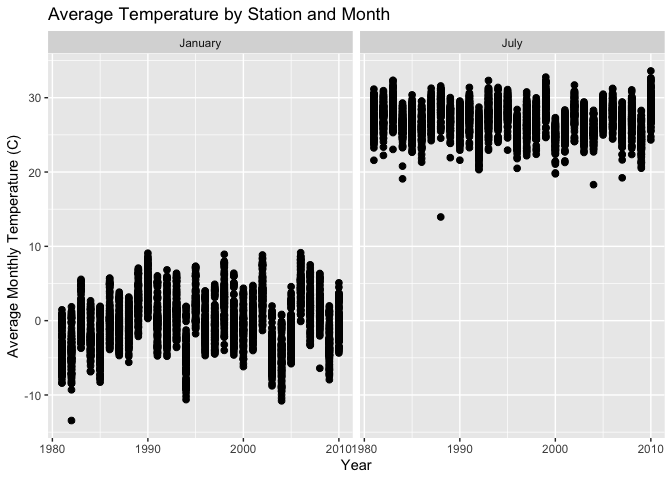
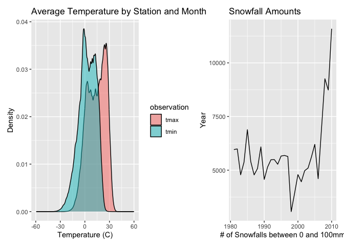

p8105_hw3_imo2121
================
Ian O’Keeffe
2026-10-14

## Problem 1

``` r
noaa_df = ny_noaa %>% 
  janitor::clean_names()

dim(noaa_df)
```

    ## [1] 2595176       7

``` r
na_count <- noaa_df %>%
  summarise(across(everything(), ~ mean(is.na(.)) * 100 ))
```

This dataframe contains 2595176 rows and 7 columns. The key variables
include date, prcp (the amount of precipitation that day, in tenths of
mm) snow (in mm), snwd (depth of the snow that day, in mm) tmax and tmin
(the maximum and minimum temperatures that day in tenths of degrees C).
Missing data is an issue here, as every weather station does not collect
every value. Accordingly, 14.69% of the snow data, 22.8% of snow depth,
and 43.71% of both temp min and temp max data are missing.

``` r
noaa_df = noaa_df %>% 
  mutate(
    day = lubridate::day(date),
    month = lubridate::month(date),
    year = lubridate::year(date),
    snow = ifelse(
      snow < 0, NA, snow
    ),
    prcp = prcp / 10,
    tmin = as.numeric(tmin) / 10,
    tmax = as.numeric(tmax) / 10
  )

noaa_df %>% 
  count(snow, name = "n_obs") %>% 
  arrange(desc(n_obs))
```

    ## # A tibble: 281 × 2
    ##     snow   n_obs
    ##    <int>   <int>
    ##  1     0 2008508
    ##  2    NA  381222
    ##  3    25   31022
    ##  4    13   23095
    ##  5    51   18274
    ##  6    76   10173
    ##  7     8    9962
    ##  8     5    9748
    ##  9    38    9197
    ## 10     3    8790
    ## # ℹ 271 more rows

We add day, month, and year columns. Snow values less than 0 were
changed to be NAs. We then adjust the prcp, tmax, and tmin to be full mm
and degrees C, respectively. The majority of counts for snowfall were 0,
since it does not snow in most places on most days.

``` r
ggp_monthly_temp = noaa_df %>%
  filter(
    month %in% c(1, 7)
  ) %>% 
  mutate(
    month = ifelse(
      month == 1, "January", "July"
    )
  ) %>%
  group_by(id, month, year) %>%
  summarize(
    avg_max = mean(tmax)
  )  %>%
  ggplot(aes(x = year, y = avg_max)) +
  geom_point(size = 2) +
  facet_wrap(~ month, ncol = 2) +
  labs(
    title = "Average Temperature by Station and Month",
    x = "Year",
    y = "Average Monthly Temperature (C)"
  )
```

    ## `summarise()` has regrouped the output.
    ## ℹ Summaries were computed grouped by id, month, and year.
    ## ℹ Output is grouped by id and month.
    ## ℹ Use `summarise(.groups = "drop_last")` to silence this message.
    ## ℹ Use `summarise(.by = c(id, month, year))` for per-operation grouping
    ##   (`?dplyr::dplyr_by`) instead.

``` r
ggp_monthly_temp
```

    ## Warning: Removed 7058 rows containing missing values or values outside the scale range
    ## (`geom_point()`).

<!-- -->
The plots of average temperatures in January and July show relatively
consistent temperatures, with a few outliers (e.g. one very cold day in
July in the late 1980s).

``` r
ggp_full_tmp = noaa_df %>%
  pivot_longer(
    tmax:tmin,
    names_to = "observation", 
    values_to = "temp") %>%  
  ggplot(aes(x = temp, fill = observation)) +
  geom_density(alpha = .5) +
  labs(
    title = "Average Temperature by Station and Month",
    x = "Temperature (C)",
    y = "Density"
  )

ggp_snowfall = noaa_df %>% 
  filter(
    snow > 0 & snow < 100
  ) %>% 
  count(year, name = "snow_count") %>% 
  ggplot(aes(x = year, y=snow_count)) +
  geom_line() +
  labs(
    title = "Snowfall Amounts",
    x = "# of Snowfalls between 0 and 100mm",
    y = "Year"
  ) +
  theme(legend.position="none")
  

ggp_full_tmp + ggp_snowfall
```

    ## Warning: Removed 2268778 rows containing non-finite outside the scale range
    ## (`stat_density()`).

<!-- --> We
made two density plots. The left compares minimum and maximum
temperature by station and month, while the right shows how often
stations recorded days with snowfalls between 0 and 100 millimeters by
year.

## Problem 2

``` r
accel_df = read.csv("./files/nhanes_accel.csv") %>% 
  janitor::clean_names() %>% 
  pivot_longer(
    min1:min1440,
    names_to = "minute", 
    values_to = "mims"
    )
covar_df = read.csv("./files/nhanes_covar.csv", skip = 4) %>% 
  janitor::clean_names() %>% 
  mutate(
    sex = as.factor(ifelse(sex == 1, "Male", "Female")), 
    education = as.factor(case_match(
      education,
        1 ~ "Less than high school",
        2 ~ "High school",
        3 ~ "More than high school"
      ))
  )
```

    ## Warning: There was 1 warning in `mutate()`.
    ## ℹ In argument: `education = as.factor(...)`.
    ## Caused by warning:
    ## ! `case_match()` was deprecated in dplyr 1.2.0.
    ## ℹ Please use `recode_values()` instead.

``` r
mims_df = accel_df %>% 
  left_join(covar_df, 'seqn')

head(mims_df, 5)
```

    ## # A tibble: 5 × 7
    ##    seqn minute  mims sex     age   bmi education  
    ##   <int> <chr>  <dbl> <fct> <int> <dbl> <fct>      
    ## 1 62161 min1   1.11  Male     22  23.3 High school
    ## 2 62161 min2   3.12  Male     22  23.3 High school
    ## 3 62161 min3   1.47  Male     22  23.3 High school
    ## 4 62161 min4   0.938 Male     22  23.3 High school
    ## 5 62161 min5   1.60  Male     22  23.3 High school

We load and tidy the datasets, pivoting the minutes into their own rows
for the acceleration csv and changing from codes to male and female. We
then left join them on the ‘seqn’ column.

``` r
mims_df = mims_df %>% 
  filter(age >= 21) %>%
  group_by(seqn) %>% 
  filter(!any(if_any(everything(), is.na))) %>% 
  ungroup() %>% 
  mutate(
    education = as.factor(education),
    minute = as.factor(minute)
  )
head(mims_df)
```

    ## # A tibble: 6 × 7
    ##    seqn minute  mims sex     age   bmi education  
    ##   <int> <fct>  <dbl> <fct> <int> <dbl> <fct>      
    ## 1 62161 min1   1.11  Male     22  23.3 High school
    ## 2 62161 min2   3.12  Male     22  23.3 High school
    ## 3 62161 min3   1.47  Male     22  23.3 High school
    ## 4 62161 min4   0.938 Male     22  23.3 High school
    ## 5 62161 min5   1.60  Male     22  23.3 High school
    ## 6 62161 min6   0.145 Male     22  23.3 High school

Change education and minute to factors, and remove rows for people under
21 years old. Remove any participants with na values.

``` r
education_table <- mims_df %>%
  count(education, sex) %>%
  pivot_wider(
    names_from = sex,
    values_from = n,
    values_fill = 0
  ) %>%
  mutate(Total = Male + Female) %>%
  arrange(education)

kable(
  education_table,
  col.names = c("Education", "Men", "Women", "Total"),
  caption = "Number of Men and Women by Education Category"
)
```

| Education             |   Men | Women |  Total |
|:----------------------|------:|------:|-------:|
| High school           | 33120 | 50400 |  83520 |
| Less than high school | 40320 | 38880 |  79200 |
| More than high school | 84960 | 80640 | 165600 |

Number of Men and Women by Education Category
